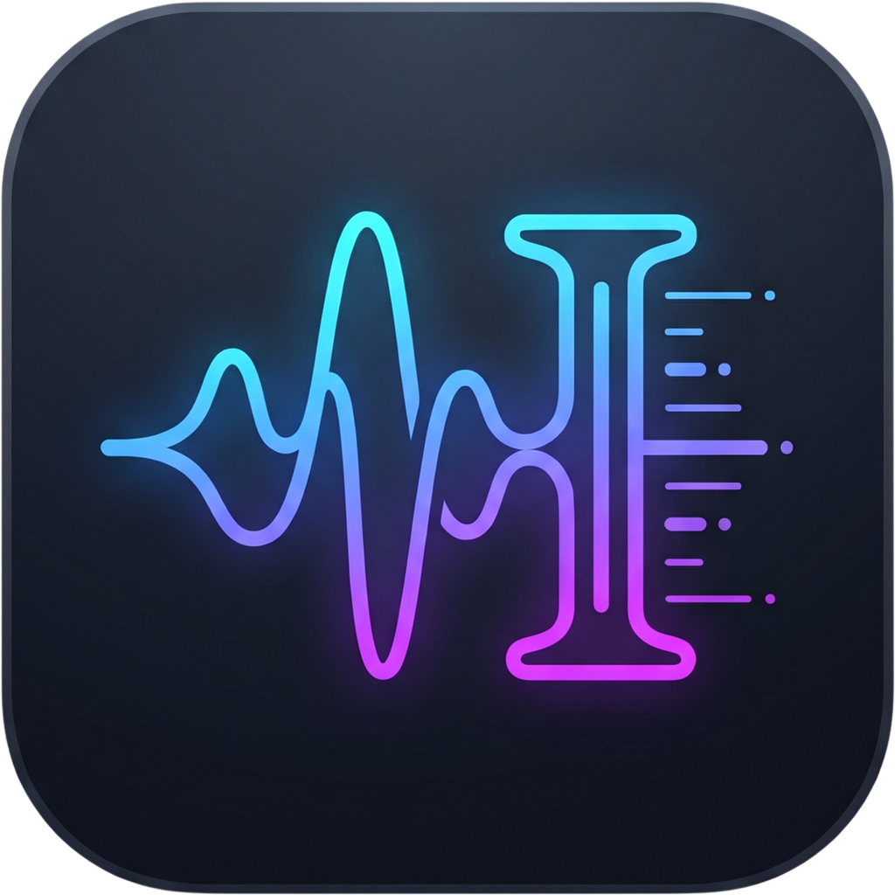

# WordCut 词剪

**基于词级对齐的播客访谈文本驱动剪辑工具。** 面向 2 小时级的访谈素材：先转写成带时间戳的词，再在文本上删改，音频/字幕/视频按删除区间精确重排。

<p align="center">
  
</p>

---

## 快速开始

### 方式一：双击（推荐）

在项目根目录双击 **`start.bat`**。脚本会自动完成：

1. 检查 Python / Node 与前端依赖（首次缺依赖会自己 `npm install`）
2. 在**同一个窗口**里启动后端（:8000）与前端（:5173），日志以 `[后端]` / `[前端]` 前缀汇总
3. 轮询 `/api/health` 与前端口，**真正就绪后**才继续（不是傻等固定秒数）
4. 打开浏览器到 <http://localhost:5173>

按 `Ctrl+C` 同时停掉前后端；`stop.bat` 用于强制收尾。

### 方式二：手动

```powershell
# 1) 后端
cd src
python -m uvicorn api:app --host 127.0.0.1 --port 8000

# 2) 前端（另开一个终端）
cd frontend
npm install          # 首次
npm run dev          # 打开 http://localhost:5173
```

### 方式三：先自检再启动

装完环境、或者拿到别人拷来的目录时，先跑一次自检：

```powershell
python scripts\ensure_models.py
```

它会逐项检查 Python 依赖、ffmpeg、CUDA 运行库、模型，缺什么直接说怎么补，
并把模型下好（见下节）。

---

## 依赖与自动下载

**仓库里不含模型，也不需要你手动下载。** 第一次点「转写」时，如果
`models/faster-whisper-small/` 不存在，后端会自动从 HuggingFace 拉取
（约 460MB），官方源不通时自动换国内镜像 `hf-mirror.com` 重试，落到
`models/faster-whisper-<名字>/`，之后直接复用。

| 依赖 | 需要什么 | 怎么来 |
|------|---------|--------|
| Python 包 | 见 `requirements.txt` | `python -m pip install -r requirements.txt` |
| 模型 | `small`（默认） | **自动下载**，或 `python scripts\ensure_models.py` 预热 |
| ffmpeg / ffprobe | 转码、视频导出 | 装到 PATH；本机在 `F:\ffmpeg\bin`，项目会自动找到 |
| CUDA 运行库 | GPU 加速（cuDNN 8 + cuBLAS 12） | `python scripts\fetch_cuda_libs.py`（约 1.7GB，缺失则自动回退 CPU） |
| 前端依赖 | Node 20+ | `start.bat` 自动 `npm install` |

想换模型（`tiny` / `base` / `medium` / `large-v3` …）：

```powershell
python scripts\ensure_models.py --model medium
# 或让服务用别的模型
set WORDCUT_WHISPER_MODEL=medium
```

离线环境（禁止联网下载）：

```powershell
set WORDCUT_NO_MODEL_DOWNLOAD=1
set WORDCUT_WHISPER_MODEL_PATH=D:\models\faster-whisper-small
```

### 环境变量一览

| 变量 | 默认 | 作用 |
|------|------|------|
| `WORDCUT_WHISPER_MODEL` | `small` | 模型尺寸 |
| `WORDCUT_WHISPER_MODEL_PATH` | 空 | 直接指定已有模型目录（优先于下载） |
| `WORDCUT_MODELS_DIR` | `<项目>/models` | 模型根目录 |
| `WORDCUT_NO_MODEL_DOWNLOAD` | 空 | `1` 时禁止自动下载 |
| `WORDCUT_WHISPER_DEVICE` | `auto` | `auto` / `cuda` / `cpu`（论文做对照实验用） |
| `WORDCUT_WHISPER_BATCHED` | `1` | `0` 关闭批处理转写（退回顺序模式） |
| `WORDCUT_WHISPER_BATCH_SIZE` | `8` | 批处理并行窗口数 |
| `WORDCUT_WHISPER_BEAM` | `5` | 顺序模式的 beam size |

---

## 环境要求

- **Python 3.10**（本机 `E:\Python\Python310`；`start.bat` 会按这个路径找）
- **Node.js 20+**（本机 `F:\nodejs`）
- **ffmpeg 6+**（带 `libx264`、`aac`；NVENC 可选）
- Windows 10/11（打包与脚本按 Windows 写的；核心代码是跨平台的）
- GPU 可选：有 NVIDIA 显卡时自动用 CUDA/fp16，实测 2 小时素材 **124 秒**转完；
  没有或驱动不匹配会自动回退 CPU/int8（约 4.6 倍慢）

---

## 常用命令

```powershell
# 跑全部测试（自定义 smoke 风格，不是 pytest）
python scripts\run_tests.py
python scripts\run_tests.py edl_render pipeline   # 只跑指定模块

# 环境自检 / 预热模型
python scripts\ensure_models.py

# CUDA 运行库（约 1.7GB）
python scripts\fetch_cuda_libs.py

# 重新生成图标（改 assets/brand/wc-source.png 之后）
python scripts\make_icons.py

# 桌面快捷方式（带图标）
powershell -ExecutionPolicy Bypass -File scripts\make_shortcut.ps1

# 生产构建（产物在 frontend/dist，可用任意静态服务器托管；
# 后端只提供 /api，不托管前端文件）
cd frontend
npm run build
```

---

## 使用流程

1. **选择文件**（音频或视频）→ 自动转 16kHz 单声道 WAV 并创建项目
2. **转写** → 词级时间戳；长素材按 10 分钟分块，边转边出，可断点续转
3. **删改** → 选中文本按 `Delete` 删除；连片删除自动合并成一段（词间停顿一并剪掉）
4. **试听** → 空格播放；波形上红色块 = 已删除区间
5. **导出** → 音频（wav/mp3/m4a）+ 字幕（SRT）+ EDL（JSON）；可选导出成品 MP4

---

## 目录结构

```
WordCut/
├─ start.bat / start.ps1        一键启动（单窗口汇总日志）
├─ stop.bat  / stop.ps1         停止本项目的前后端
├─ requirements.txt             Python 依赖（版本已锁定）
├─ src/                         后端
│  ├─ api.py                    FastAPI 接口（上传/转写/编辑/导出）
│  ├─ pipeline.py               词表 → EDL → 渲染 → 字幕 → 导出
│  ├─ edl_render.py             按删除区间渲染（O(n)，预分配+原地交叉淡化）
│  ├─ model_fetch.py            模型定位与自动下载（含镜像回退）
│  ├─ model.py                  Token / DeleteSpan / EDL / TimeMap
│  ├─ media/                    ffmpeg 封装（转码、切视频、降噪）
│  └─ test_*.py                 各模块 smoke 测试
├─ frontend/                    Vue 3 + Vite + WaveSurfer
│  ├─ public/                   图标与 manifest
│  └─ src/
│     ├─ App.vue                主界面与状态机
│     ├─ components/            工具栏 / 波形 / 编辑器 / 对话框
│     ├─ composables/           播放器封装
│     └─ core/                  命令注册表、快捷键
├─ scripts/                     运维与生成脚本
├─ docs/                        设计文档（先看「项目纲领」与「不变量」）
├─ assets/brand/                图标母版
├─ models/                      模型（gitignore，首次自动下载）
├─ libs/cuda/                   CUDA 运行库（gitignore）
├─ uploads/ outputs/ data/      运行期数据（gitignore）
```

---

## 开发约定

- **测试**：不用 pytest，每个 `src/test_*.py` 自带 `check(name, cond)`，
  打印 `PASS:` / `FAIL:`，有失败就以非零码退出。改动前后都要全绿（当前 154 项）。
- **提交信息**：`动词(模块): 说明`，例如 `fix(波形): 缩放条改用 WaveSurfer 滚动 API`。
- **不变量**：见 `docs/不变量.md`。核心几条：源文件只读、时间一律用秒（float）、
  EDL 可逆、`token.id` 不重排、`start < end`。
- **文档**：改行为就同步 `docs/`；界面/交互问题记到 `docs/界面问题清单.md`。

---

## 常见问题

**Q：转写很慢 / 显示用的是 CPU？**
看启动窗口里的 `[后端]` 日志与 `GET /api/health` 的 `whisper_device`。
若是 `cpu`，通常是缺 CUDA 运行库：跑 `python scripts\fetch_cuda_libs.py`，
或用 `python scripts\check_cuda.py` 看具体原因（驱动、cuDNN 版本）。

**Q：模型下载卡住 / 失败？**
可以手动下载 `Systran/faster-whisper-small` 的四个文件
（`model.bin`、`config.json`、`tokenizer.json`、`vocabulary.txt`）放到
`models/faster-whisper-small/`，或用 `WORDCUT_WHISPER_MODEL_PATH` 指向别处。

**Q：端口被占用？**
`start.bat` 检测到 8000/5173 已被占用会直接复用；要强制重来就 `start.bat -Restart`。

**Q：pip 装不上（代理报 FileNotFoundError）？**
换国内源：`python -m pip install -r requirements.txt -i https://pypi.tuna.tsinghua.edu.cn/simple`。
本机还准备了 `scripts/fetch_cuda_libs.py` 这种"下 wheel 直接解包"的方式可参考。

**Q：2 小时素材要多久？**
转写（GPU 批处理）约 2 分钟；纯音频导出约 1 秒；带视频导出约 3 分钟（要重编码裁剪点）。

---

## 文档索引

| 文档 | 内容 |
|------|------|
| `docs/项目纲领.md` | 产品目标、范围与优先级（P0–P3） |
| `docs/不变量.md` | 数据模型与不可破坏的约束 |
| `docs/术语表.md` | Token / DeleteSpan / EDL / TimeMap 等 |
| `docs/启动说明.md` | 启动细节、图标、快捷方式 |
| `docs/架构预留设计.md` | 插件、轨道、翻译等预留位 |
| `docs/界面问题清单.md` | 逐轮反馈与修复记录（含实测数据） |
| `docs/待办与推后事项.md` | 批次化的待办与明确推后的需求 |
| `docs/项目状态卡.md` | 当前进度快照 |

---

## 已知限制

- 分段转写（10 分钟一块）在块边界可能切断个别词；断点续转不会回退重转
- 视频导出必须重编码剪辑点附近，2 小时素材约 2–3 分钟
- 词级时间戳来自 Whisper，边界有 ±50–150ms 误差
- 暂不支持多轨、效果链、多用户协作（见纲领 P3）
